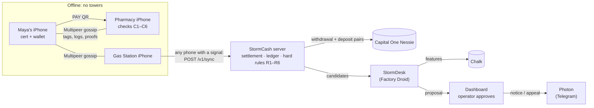
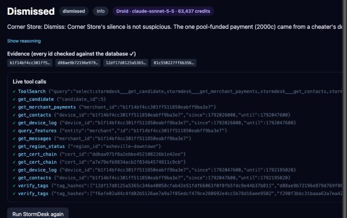
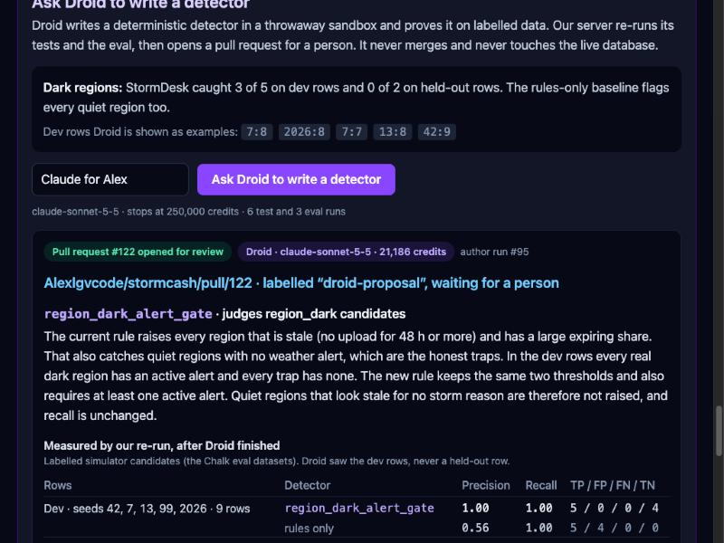
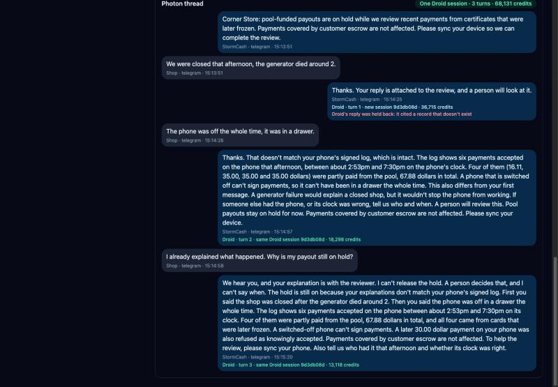

# StormCash

When a disaster takes out towers and card readers, StormCash keeps phones paying local shops, and stops cheaters with no internet.

> "I tried to cheat it with no internet, and it refused me."

HackHarvard 2026 · Digital Trust track · Capital One Nessie · Factory Droid SDK · Chalk · Photon. The full design lives in [`STORMCASH_BUILD_SPEC.md`](STORMCASH_BUILD_SPEC.md).

## The problem

After Hurricane Helene (2024), card readers in western North Carolina couldn't connect, most ATMs were down or empty, and some shops stayed cash-only for a month. People had money in the bank and phones with battery, and still couldn't pay, because every payment app needs a server to approve each payment.

## How it works

1. **Bank-backed certificate.** The resident's bank (Capital One, through Nessie) locks money in an escrow account, and the StormCash server signs a certificate for the phone's key: "this phone may spend up to $X". The always-on cap is $20; Storm Mode raises it to $50.
2. **Pay offline by QR.** The shop's phone checks the bank's signature and the resident's signature with no network (checks C1–C6), and shows "Backed by Capital One, $12 of $50 used".
3. **Spend tags travel phone to phone.** Every payment is a signed, chained spend tag. Phones gossip tags over Bluetooth and peer Wi-Fi (Apple Multipeer); customers carry them from shop to shop. A rolled-back wallet trying to spend the same money again is **refused offline** by the next shop that holds the tag, and the two conflicting signatures are **self-proving evidence** anyone can check.
4. **Store and forward.** Payments, tags and signed device logs hop phone to phone until any phone gets a signal and uploads them. The server pays shops through Nessie, freezes cheaters, and sends receipts, the freeze list and renewed certificates back the same way.
5. **"Merchant knew."** Every phone keeps a signed, hash-chained log of what it accepted and whom it met. A shop that accepted a double spend while holding the conflicting tag is caught by its own signature.
6. **StormDesk.** A back-office agent built on Factory's Droid SDK investigates hard cases and triages suspicious patterns from deterministic detectors. A second Droid session reviews each proposal and tries to refute it. A person approves. Shops get notices and can appeal by text through Photon.

**Math flags. The agent investigates. A person decides.**



## Honest limits

- **Offline double spending is bounded, not impossible.** A shop no tag has reached can be fooled once, up to the cap; settlement proves it and the guarantee pool pays the shop.
- The wallet counter lives in app storage, not a secure chip (a Secure Enclave key is optional and off by default).
- iPhones only exchange data while the app is open.
- Phones share pseudonymous certificate ids, amounts and running totals, never names. Payments relayed for settlement name the shop they paid; production would encrypt relayed bundles to the server's key.
- The 40-shop town around our 3 phones is **simulated** and labelled "simulated" everywhere; its money never touches Nessie. Weather alerts we replay are labelled "replayed".
- **StormDesk costs Factory credits.** On the seeded town a hard-case investigation took 12,000 to 17,000 credits and a shop triage 43,000 to 70,000 (`claude-sonnet-5-5`). Each run stores its model, tokens and credits, shown next to the Droid badge. We run Droid on the cases an operator opens (`STORMDESK_RUNNER=droid STORMDESK_AUTO=0`). Everything else, and any run Droid can't make (no credits, no CLI), goes through a deterministic stand-in that applies the rules-only baseline. It is labelled "Fake runner · rules only" on every screen and in every stored record, and is never presented as an agent's judgement. The reviewer Droid adds a second session to every triage: 16,828 and 56,198 credits on its first two live reviews.
- **Droid disagrees with our planted label.** On seed 42 it dismissed the Corner Store, which the simulator plants as a colluder, twice:
  - The first time the shop had taken a single pool-funded payment, already covered by a hard case. So we changed the scenario: the colluder now takes pool money from several cheaters while silent (#82).
  - On the new town, Droid read the four cheaters' re-spends as the shop being their victim. It flagged the pattern for the operator to watch but proposed no action.
  - That second answer also cited one id it had mis-copied (40 right characters, then made-up ones), so the citation check stored it as invalid and it can't be approved.
  - With prompt v2 (next point), it flagged the shop. It weighed the shop's silence, the 67% pool-funded share and the 4 caught cheater certificates together, proposed holding pool payouts, and noted that the neighbour baseline was thin. Citations valid, 70,319 credits.

  We show every answer as it is.
- **The author job is macOS only** (it needs `sandbox-exec`) and refuses to run elsewhere. Its first detector's perfect score is on simulated towns that plant the very pattern it relies on (see "Droid writes a detector").
- **StormDesk's prompt is v2, and its eval is not a blind holdout.** The first real eval (v1, 43 rows) caught 2 of 23 real cases. It dismissed stolen phones because their escrow covered every cent, and colluding shops as the cheaters' victims. We then added general principles to the prompt (a drained escrow is the resident's loss; weigh a shop's silence, pool-funded share and number of cheater certificates together). Those principles were written after reading v1's errors on that same dataset, so a v2 score on it is not a blind test. Each run records its prompt version.

## Run it

**Server** (Python 3.11, Postgres). Details in [`server/README.md`](server/README.md):

```bash
cd server && python3.11 -m venv .venv && source .venv/bin/activate && pip install -e ".[dev]"
```

```bash
cp .env.example .env
```

A fresh database gets the whole schema (`psql "$DATABASE_URL" -f schema.sql`); an older one gets the files in `server/migrations/`.

```bash
uvicorn --factory stormcash.app:create_app --host 0.0.0.0 --port 8000
```

**Dashboard.** Build it once and the server serves it at `/`, along with the public proof page at `/proof/<case_id>`. Details in [`dashboard/README.md`](dashboard/README.md):

```bash
cd dashboard && npm ci && npm run build
```

**Public URL.** Judges' phones open the proof page over HTTPS (WebCrypto needs it); set `PUBLIC_BASE_URL` in `server/.env` to the tunnel's URL:

```bash
cloudflared tunnel --url http://localhost:8000
```

**Simulated town.** This runs 72 simulated hours ending now, with the planted demo cases. Details in [`sim/README.md`](sim/README.md):

```bash
pip install -e ./sim
```

```bash
curl -X POST localhost:8000/v1/demo/seed-town -H 'X-SC-Operator: alex' -H 'content-type: application/json' -d '{"seed": 42}'
```

**Phones.** Expo development build on iPhone with free signing: [`mobile/README.md`](mobile/README.md).

**Photon bridge.** Telegram sending runs through a small Node process: [`server/stormcash/photon/README.md`](server/stormcash/photon/README.md).

**Between judges.** This clears the real phones' data, opens fresh Nessie accounts and reissues Maya's certificate. The simulated town stays.

```bash
curl -X POST localhost:8000/v1/demo/reset -H 'X-SC-Operator: alex'
```

**Pre-flight before every judge (demo dry run).** Run it before each judging slot and after any merge, before a phone is touched. Three labelled test identities ("Dry-run Maya", "Dry-run Pharmacy", "Dry-run Gas Station") play the phones' side of the 2:30 script through the real API. They use the real protocol library and keys of their own, never the real Maya's. Each beat prints ✓ or ✗:

- the server key matches `SERVER_PUB` and the schema is current
- registration, and Storm Mode's $20 → $50 in Nessie
- the $12 payment through C1–C6
- both judge-mode rollbacks refused by C6
- the gas station's 2-hop upload: settled in Nessie, case opened, cert frozen, new POLICY
- the proof, and the town's Corner Store flag

It takes about 15 s against the hosted database and ends with the demo reset, so register Maya's phone again afterwards. It never starts StormDesk: the worker skips dry-run identities, and the dry run refuses a server that can't confirm that. The exit code is 0 only when every step passed, and `--keep` skips the cleanup. Details in [`server/README.md`](server/README.md#demo-dry-run):

```bash
cd server && python -m stormcash.dryrun --base-url http://localhost:8000
```

**Fallback switches** (`server/.env`):

| Switch | Effect |
|---|---|
| `NESSIE_DISABLED=1` | money is ledger-only (no Nessie calls) |
| `API_SIG_REQUIRED=0` | accept unsigned phone writes |
| `STORMDESK_RUNNER=fake` | StormDesk uses the labelled rules-only stand-in |
| `STORMDESK_AUTO=0` | don't run StormDesk automatically |
| `STORMDESK_REVIEW=0` | no reviewer Droid after each triage |
| `PHOTON_DISABLED=1` | record messages on the dashboard, send nothing |

Queued Nessie payouts replay on their own every 10 s.

**Tests.** The protocol test vectors are shared by Python and TypeScript (`spec/vectors.json`):

```bash
cd server && pytest
```

```bash
cd sim && pytest
```

```bash
cd dashboard && npm test
```

```bash
cd mobile && npm test
```

## Where Droid runs

StormDesk is the back office of the running product, in [`server/stormcash/stormdesk/`](server/stormcash/stormdesk/):

- **`worker.py`**: picks up every new hard case and every new detector candidate, with at most 4 Droid sessions at once. Nothing has to ask for it: when a phone uploads and a rule or a detector fires, the job is queued.
- **Four jobs** (`runner.py`, `prompt.py`):
  - **Investigate** a hard case. It re-verifies both signatures and the rule with the deterministic verifier, works out who was paid from escrow and from the pool, and writes a case file.
  - **Triage** a candidate (a shop went quiet, a certificate drained fast, a region went dark). It decides whether it's real, cites the evidence, and proposes an action, or dismisses it with a reason.
  - **Review** every triage before a person sees it. A second Droid session with its own prompt tries to refute the proposal. It re-runs the tools itself and checks that every cited record exists and supports the claim. It gets StormDesk's structured output, never its transcript.
  - **Respond** to a shop's appeal arriving through Photon, by comparing the claim with the shop's own signed logs. Each appeal is one conversation: its thread keeps one Droid session, resumed with `Session.resume` for every new text, so the agent remembers what the shop has already said.
- **Agents check agents, a person decides** (`service.after_review`). If the reviewer agrees, the flag goes to the operator as proposed. If it disagrees, or says the evidence can't settle it, the flag is marked "Agents disagree · a person decides" and kept open, a dismissal included, with both views side by side. The reviewer can't act: Approve runs only StormDesk's proposal. A review that cites a record that doesn't exist doesn't count. The rules-only stand-in reviewer is labelled and never escalates. `STORMDESK_REVIEW=0` turns the reviewer off.
- **Eleven read-only tools** (`tools.py`) served to Droid as an in-process MCP server: `get_case`, `get_candidate`, `get_cert_chain`, `verify_tags`, `get_device_log`, `get_contacts`, `get_merchant_payments`, `query_features`, `get_region_status`, `get_nessie_balances`, `get_messages`. They run in a read-only database transaction. **There is no write tool.**
- **Structured outputs** (`schemas.py`): `Flag`, `CaseFile`, `Review` and `AppealReply` are Pydantic models passed as `output=` to `Session.stream`. A failed structured output is retried once and otherwise stored as invalid.
- **Permission handler** (`runner.permission_handler`): allows only our own MCP tools and cancels everything else (shell, file edits, network). All 34 built-in tools (ids from `list_tools()` on droid 0.244.0) are also switched off in `SessionConfig`. One exception shows up in every live transcript: Droid's `ToolSearch` still runs once, to load our MCP tools' schemas.
- **Citation check** (`citations.py`): every id the agent cites must exist in the database, or the result is stored as invalid and never shown as actionable. The reviewer's citations are checked the same way.
- **Every run is stored** with its transcript, model, tokens and Factory credits (`stormdesk_runs`). Each tool call streams live to the dashboard (`stormdesk_step` events). A stored run can be replayed step by step ("Replay of run at …").
- **A person decides.** Approve or Reject on the dashboard runs deterministic code (`approvals.py`): hold a shop's pool payouts, lower its limit, freeze a certificate, or dispatch a relay. Hard rules never go through the agent.
- **The Droid tab** on the dashboard (`#droid`, `GET /v1/droid/console`) shows all of this from the stored runs: every Droid run with its model, prompt version, credits, time and outcome, a click-through to its tool calls, totals per job, and the guardrails that actually fired (invalid citations rejected, fallbacks). Fake-runner runs are labelled and never counted as Droid's.



_A live Droid run (`claude-sonnet-5-5`) triaging the Corner Store candidate on the seeded town: 14 read-only tool calls streamed to the dashboard, 63,437 Factory credits. With prompt v1 it dismissed the candidate; with prompt v2 the same candidate is flagged (see Honest limits)._

**First live reviews** (`claude-sonnet-5-5`, seed 42). The reviewer re-checked prompt v2's Corner Store flag in 13 tool calls and agreed. All 10 ids it cited were valid; it took 56,198 credits and 44 s. On a stolen phone (Resident 174) it agreed with freezing the certificate in 8 tool calls (16,828 credits, 30 s). It also noted that the proposal's text had missed the region mismatch and the idle gap. Neither shows a disagreement. **Reviewer eval** (Chalk Evaluations, held-out seeds 1 and 2, the 20 stored prompt-v2 proposals from run `51b74f56…`; only the reviewer ran, 799,185 credits, all `claude-sonnet-5-5`). Chalk runs `28f97eca-0402-4c86-9c76-5e380eae6dc0` (v2 alone) and `e3ecc828-c97e-41d3-9cf8-d7185b3d8013` (v2 + reviewer):

| | v2 alone | v2 + reviewer |
|---|---|---|
| Real cases that reach a person | 6 / 9 | 8 / 9 |
| Honest subjects that reach a person | 0 / 11 | 0 / 11 |
| Invalid citations reaching a person | 0 | 0 |

The reviewer agreed 17 times, disagreed once and said the evidence was insufficient twice, so 3 rows were escalated to a person. Two of those were real cases v2 had dismissed. The one disagreement was with v2's correct hold on Corner Store, which was already in front of a person. The reviewer never changes the proposal; it only decides whether a person must look.

### Droid writes a detector; a person merges it or not

The one job where Droid writes code ([`author.py`](server/stormcash/stormdesk/author.py), [`sandbox.py`](server/stormcash/stormdesk/sandbox.py), [`detector_eval.py`](server/stormcash/stormdesk/detector_eval.py)). On the Evals tab an operator clicks **Ask Droid to write a detector** for a gap the evals found, or calls `POST /v1/stormdesk/author-detector`. The first gap: StormDesk v2 caught 0 of 2 dark regions on held-out towns, and the rules-only baseline flags every quiet region too.

- **Sandbox.** A throwaway git worktree of `origin/main` in a temp directory, with no `.env`. Droid's built-in Create and Edit tools are on, and the permission handler allows them on two files only: `server/stormcash/detectors_proposed/<name>.py` and `server/tests/test_proposed_<name>.py`. Every refusal is recorded.
- **No shell.** We found that Droid's CLI auto-runs commands it rates read-only (`ls`) without asking the permission handler, so its shell is off. The two allowlisted commands are two tools, `run_tests` and `run_eval`, and Droid reads through our tools, confined to the worktree and blind to held-out rows.
- **Two OS sandboxes.** The `droid` CLI runs under a macOS sandbox profile with a scrubbed environment: it writes only inside the sandbox and can't read `.env`, credentials or held-out data. The tests and the eval run in a second profile with no network, so no database.
- **Measured.** The evaluation script runs the detector, a pure function checked before import, over the labelled candidates of the Chalk eval datasets, next to the rules-only detector. Droid may read the dev seeds; of the held-out seeds 1–3 it only ever sees aggregate counts.
- **Checked by our code, not Droid.** After the session closes, the server checks that only the two files changed, that the detector is pure and that no secret is in them. Then it re-runs the tests and the eval itself, and rejects the run if anything in Droid's `DetectorProposal` differs: name, files, test result or any number.
- **Hand-off.** Only then does deterministic code commit the two files as the repo owner and open a PR, "Detector proposed by Droid: <name>", with the rationale, our re-run's metrics, the run id, model and credits. It is labelled `droid-proposal` and never merged by code. Nothing calls the detector until a person merges a follow-up that wires it into `detectors.run_incremental`.
- Every run is a `stormdesk_runs` row with `job = 'author'`, on the Droid tab. `STORMDESK_AUTHOR=1` turns it on.

**First live run** (run #95, `claude-sonnet-5-5`, 21,186 Factory credits, 36 s, 0 permission denials). Droid proposed `region_dark_alert_gate`: keep the two existing thresholds, and also require an active weather alert. Our re-run matched every number, and it opened [Alexlgvcode/stormcash#122](https://github.com/Alexlgvcode/stormcash/pull/122), left open for a person.

| Rows | Detector | Precision | Recall |
|---|---|---|---|
| Dev (seeds 42, 7, 13, 99, 2026; 9 rows) | `region_dark_alert_gate` | 1.00 | 1.00 |
| | rules only | 0.56 | 1.00 |
| Held-out (seeds 1, 2, 3; 6 rows) | `region_dark_alert_gate` | 1.00 | 1.00 |
| | rules only | 0.50 | 1.00 |

Droid's own caveat, and ours: the simulator plants an alert on every dark region and none on the quiet-region traps, so the perfect score shows the rule fits the simulator, not that it holds in a real town. A region that goes dark before any warning would be missed, and 15 rows is a small sample.



## How we use Chalk

- **Features for the agent.** StormDesk's `query_features` tool asks for a shop's, certificate's or region's features: contact rates against nearby shops, pool-funded share, drain speed, upload gaps, active weather alerts. The Chalk feature set (#28) builds them from our Postgres data, Nessie balances and the National Weather Service alerts API. If Chalk is off or can't answer, the tool answers from the detectors' own frozen features and says so (`source: "postgres_fallback"`).
- **Evaluations.** The simulator writes ground truth for every seeded town (`sim/out/<seed>/labels.json`), including deliberate traps: a remote shop, a victim shop, an honest resident stocking up, a drifting clock and a quiet region. Chalk Evaluations compares the rules-only baseline with StormDesk on those labels (#33). The Evals tab shows only numbers from a real run.
- **Results** (real Chalk runs, StormDesk on Droid with `claude-sonnet-5-5`, prompt version recorded on every row):

  **Held-out towns.** Seeds 1 and 2 were chosen and committed before any of their rows existed and were never seen while prompt v2 was written (20 rows, 11 honest). Seed 3 was chosen too but didn't fit in the credit budget, by a rule written down before the run.

  | | Rules only | StormDesk, prompt v2 |
  |---|---|---|
  | Chalk run | `dc1fd4c9-734e-408d-8c48-9c583dcb3867` | `51b74f56-d8d8-466b-a07c-3ddf8baa8064` |
  | Real cases caught | 9 / 9 | 6 / 9 |
  | Stolen phones · colluding shops · dark regions | 4/4 · 3/3 · 2/2 | 4/4 · 2/3 · 0/2 |
  | Honest subjects wrongly flagged | 11 / 11 | 0 / 11 |
  | Evidence citations valid | n/a | 20 / 20 |

  **Main dataset** (43 rows from seeds 42, 7, 13, 99 and 2026). Prompt v2 was written after reading v1's errors on these rows, so its score here is not a blind test.

  | | Rules only | StormDesk, prompt v1 | StormDesk, prompt v2 |
  |---|---|---|---|
  | Chalk run | `71142eed-2864-413d-ac27-da1e3c537e50` | `a91828a0-342b-4030-b046-a926fe5ade9d` | `4119a11e-018f-41ae-86fc-9cede513969f` |
  | Real cases caught | 23 / 23 | 2 / 23 | 14 / 23 |
  | Stolen phones · colluding shops · dark regions | 9/9 · 9/9 · 5/5 | 0/9 · 1/9 · 1/5 | 9/9 · 2/9 · 3/5 |
  | Honest subjects wrongly flagged | 20 / 20 | 2 / 20 | 3 / 20 |
  | Evidence citations valid | n/a | 42 / 43 | 37 / 43 |

  Rules alone catch everything and flag every honest subject. Prompt v1 was far too lenient. Prompt v2, on towns it had never seen, caught every stolen phone and 2 of 3 colluding shops and wrongly flagged no honest subject, but it caught no dark region. It still lets some colluders through, and on the main set 6 of its 43 answers cited a record that doesn't exist; those are stored as invalid and never shown as actionable. That's why a person approves every action. An earlier v2 attempt that stopped at its credit cap after 32 of 43 rows (`aca3204b-db75-4908-a388-4594d4ee97a7`) is recorded as incomplete and is not a score. Factory credits: v2 main run 1,815,847; held-out run 937,859.

## How we use Capital One Nessie

- Each real resident has a **checking** account and a **StormCash escrow** account. The guarantee **pool** belongs to a "StormCash Operator" customer, and each real shop has its own account.
- **Every money movement is a matched pair:** a withdrawal on the source account and a deposit on the destination, both described `SC <txn_id> …` so they link to our double-entry ledger. This covers locking escrow, the Storm Mode top-up, paying a shop from escrow or from the pool, and refunding on close.
- **Balances are read live from Nessie** as opening balance + deposits − withdrawals, and the Accounts tab labels them "from Nessie transactions". The ledger beside them must balance ("Ledger balanced ✓").
- Nessie amounts are whole dollars; one helper converts cents to dollars and refuses anything else rather than rounding.
- **If Nessie is slow or down**, the payout is queued and replayed until both halves exist; a payout is "executed" only when they do. Every call is in the dashboard's Nessie call log.
- Simulated money never touches Nessie.
- **Reconciled with the bank.** `GET /v1/accounts/reconcile` and the Accounts tab's "Reconciled with Capital One Nessie" panel compare, account by account in cents, what our ledger says with what Nessie's own records add up to. They show ✓, or the difference with its cause taken from real data: a queued payout, half a pair, a ledger-only amount, or a Nessie record with no ledger entry. Each demo reset opens a fresh guarantee pool account, so the pool's records start clean.

## How we use Photon

StormCash talks to shop owners over Telegram through Photon. When an operator approves a hold or a lower limit, the shop gets a notice whose numbers must all come from the flag's evidence. A shop's reply is answered by StormDesk, citing the shop's own signed logs, and anything uncertain is escalated to a person. Real shops with a registered handle also get a "Paid" notice when Nessie pays them.

**An appeal is one conversation with one agent.** Each shop's appeal thread keeps one Droid session. Every new text resumes it (`Session.resume`) as a new turn, with the same read-only tools, permission handler and citation check. So StormDesk remembers what the shop has claimed, and weighs each new message against the earlier ones and the shop's signed logs. In a live appeal on the Corner Store's flag (`claude-sonnet-5-5`, texts sent as simulated webhooks), the shop first said it was closed because the generator died, then that the phone was off in a drawer, then "I already explained what happened. Why is my payout still on hold?" The third reply answered from the conversation: "First you said the shop was closed after the generator died around 2. Then you said the phone was off in a drawer the whole time." It added that the signed log shows six payments accepted that afternoon, and that a switched-off phone can't sign payments. The three turns took 36,715, 18,298 and 13,118 Factory credits. The first turn's reply was never sent: it cited the flag's number, which isn't a record, so the citation check held it back, the shop got a neutral acknowledgement, and the next turn was told. The dashboard thread labels each reply with its turn of the same Droid session, and the Droid tab counts the turns. If a session can't be resumed, a new one starts from the stored thread. `STORMDESK_APPEAL_SESSIONS=0` goes back to one run per message.



**Residents can freeze a stolen wallet by text.** A resident whose Telegram handle is registered texts `FREEZE`. The server freezes their certificates through the same deterministic code as any other freeze (never through the agent), publishes a new signed freeze list that spreads to phones by gossip, and texts back a confirmation. Texting can't unfreeze, and unknown handles change nothing. The request also feeds the stolen-phone detector (`owner_freeze_request` in `cap_drain`).

Details: [`server/stormcash/photon/README.md`](server/stormcash/photon/README.md).

## Team

| Role | Who | Owns |
|---|---|---|
| **Person A — Mobile** (Mac 1) | Brian Maina ([@brianmmaina](https://github.com/brianmmaina)) | `mobile/`, WS0 TypeScript review, WS7 Photon, backup video |
| **Person B — Server, dashboard, integration** (Mac 2) | Alexandre Lugovoi ([@Alexlgvcode](https://github.com/Alexlgvcode)) | `server/`, `dashboard/`, `sim/`, `chalk/`, WS0 Python review |

## C++ toolkit

[`cpp/`](cpp/README.md) holds `stormcash-verify`, a third implementation of the protocol's checking side next to the Python server and the TypeScript phones, written in C++20 from the spec. It reproduces all 124 shared test vectors (canonical strings, digests, transport JSON, signatures and every rule from C1–C6 and R1–R6), and checks a case proof from `GET /v1/proof/{case_id}` offline: `stormcash-verify proof proof.json --server-pub <key>`. The public proof page runs the same check in the judge's browser, compiled to WebAssembly, as a second check next to WebCrypto: "Verified by 2 independent implementations" when both agree, with no code shared between them. It has its own P-256 (p256-m) and SHA-256 there, and OpenSSL natively. CI runs every test and vector with both crypto backends, plus Project Wycheproof's P-256 tests (`cpp` job), and checks the committed WebAssembly against the sources (`wasm` job). If the WebAssembly can't load, the page says so and WebCrypto's result stands alone.

[`cpp/scale/`](cpp/scale/README.md) is Scale Lab (`stormcash-scale`), a **simulated** city-scale version of the §16 town: the same gossip and rules on a grid of town tiles, from one town up to a million residents, with Monte Carlo replicates on a thread pool. It is checked against the Python simulator before any scaled-up number is reported, and every result it writes is labelled simulated.

## Repo layout

| Folder | What | Workstream |
|---|---|---|
| `spec/` | Test vectors shared by Python and TypeScript | WS0 |
| `server/` | FastAPI server, settlement, ledger, Nessie, StormDesk, Photon | WS2, WS5, WS7 |
| `mobile/` | Expo / React Native iPhone app | WS1 |
| `dashboard/` | React dashboard and public proof page | WS3 |
| `sim/` | 40-shop town simulator | WS4 |
| `chalk/` | Chalk features, resolvers and evals | WS6 |
| `cpp/` | C++ toolkit: `stormcash-verify` (independent verifier for the vectors and case proofs; also the proof page's second check, as WebAssembly) and Scale Lab (simulated city-scale gossip) | — |
| `fixtures/` | Replayed NWS alerts | — |

## Workflow

1. Pick an issue assigned to you. Each issue has a workstream label and a milestone (the schedule block it belongs to).
2. Pull the latest `main`, then branch off it with a `feat/` name, e.g. `feat/ws2-settlement`.
3. Commit your work on that branch and push it.
4. Open a pull request into `main`, fill out the PR template, and link the issue (`Closes #12`).
5. Whoever opened the PR merges it once it's ready (**Squash and merge** is the only option, so each PR becomes one commit on `main`).
6. GitHub deletes the branch automatically after the merge; locally, switch back to `main`, pull, and run `git fetch --prune`.

`main` is protected: no direct pushes, no force pushes, and no deleting it. Every change goes through a PR. Server secrets go in `server/.env` (copy [`server/.env.example`](server/.env.example)); never commit it.
